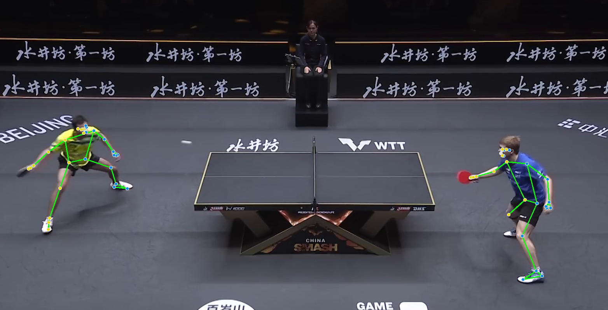

# Projet3_AnalyseSportive

L'analyse sportive moderne cherche à analyser les décisions tactiques et la gestuelle des joueurs.  Dans l'article de référence, les auteurs combinent la vision par ordinateur, l'apprentissage  automatique et la vérification formelle pour analyser les stratégies de jeu. 

## Pipeline de vision

Nous avons utilisé MediaPipe Pose en Python. Elle permet la détection de repères tels que les hanches, les épaules, etc. sur un corps humain dans une image ou dans une vidéo. Dans notre cas nous allons traiter des vidéos.
Chaque image de la vidéo est traitée de la manière suivante:
- lecture puis conversion en rgb
- conversion en image MediaPipe avec **mp.Image(image_format=mp.ImageFormat.SRGB, data=rgb_image)**
- exécution de la détection avec **landmarker.detect_for_video(mp_image, timestamp_ms)**
- **draw_landmarks_on_image(rgb_image, pose_landmarker_result)** dessine la détection sur l'image
- affichage

Pour l'instant, la détection n'est pas stable sur certaines images. À améliorer.

